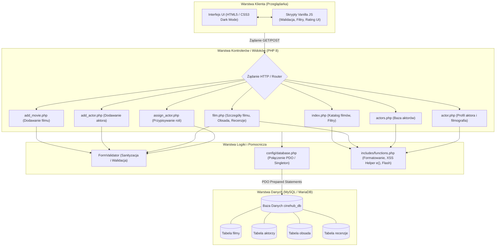
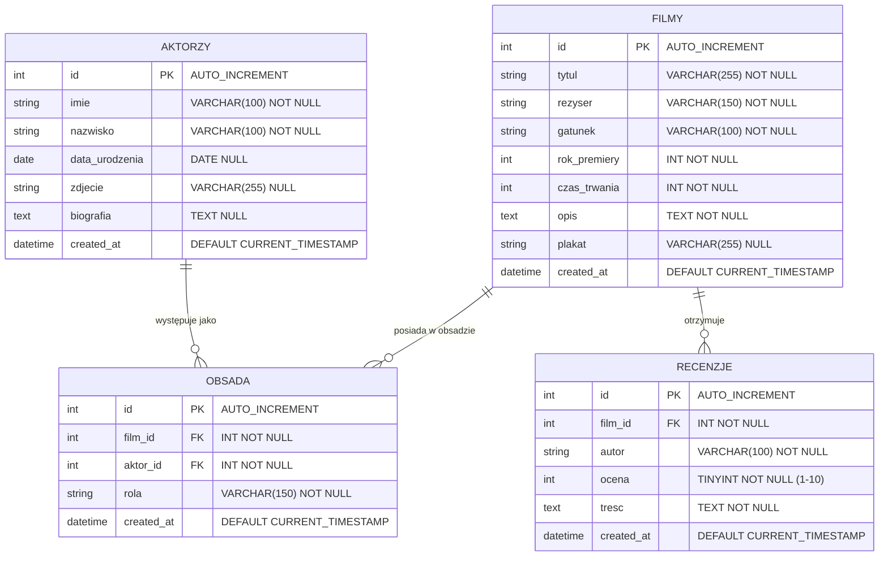

# SPECYFIKACJA TECHNICZNA I FUNKCJONALNA PROJEKTU CINEHUB
**Dokument wygenerowany przez:** Planner  
**Projekt:** Aplikacja Bazy Filmów (PHP / MySQL) – Zgodność z Kwalifikacją INF.03  
**Wersja:** 1.0  
**Status:** Zaakceptowana do realizacji  

---

## 1. Wstęp i Cel Projektu

Celem projektu jest stworzenie nowoczesnej, bezpiecznej i wydajnej aplikacji internetowej **CineHub** służącej do katalogowania filmów, zarządzania bazą aktorów, wiązania ról filmowych (relacja wiele-do-wielu) oraz publikowania i agregowania recenzji użytkowników.

Projekt powstaje zgodnie z najlepszymi praktykami programistycznymi oraz standardami egzaminacyjnymi kwalifikacji **INF.03** (*Tworzenie i administrowanie stronami i bazami danych oraz aplikacjami internetowymi*).

---

## 2. Wymagania Funkcjonalne

### 2.1 Moduł Filmów
- **Lista filmów (Strona główna / Katalog):**
  - Prezentacja filmów w formie czytelnych kart (plakat, tytuł, rok premiery, gatunek, czas trwania, wyliczona średnia ocena).
  - Wyszukiwarka tekstowa (po tytule) oraz filtrowanie według gatunku i roku premiery.
  - Sortowanie (po dacie dodania, roku premiery, średniej ocen).
- **Szczegóły filmu:**
  - Karta informacyjna filmu (pełny opis fabuły, reżyser, data premiery, czas trwania, plakat).
  - Sekcja obsady aktorskiej z wyszczególnieniem nazwy granej postaci.
  - Sekcja recenzji ze średnią oceną społeczności oraz liczbą recenzji.
  - Formularz dodawania nowej recenzji.
- **Zarządzanie filmami:**
  - Formularz dodawania nowego filmu do bazy wraz z walidacją danych.

### 2.2 Moduł Aktorów
- **Katalog aktorów:**
  - Przeglądanie listy aktorów (zdjęcie, imię, nazwisko, data urodzenia).
- **Profil aktora:**
  - Szczegółowe informacje: biografia, data urodzenia, zdjęcie.
  - Filmografia: lista filmów z bazy, w których dany aktor zagrał, wraz z nazwą odgrywanej postaci i odnośnikiem do filmu.
- **Dodawanie aktora:**
  - Formularz wprowadzania nowego aktora do bazy.

### 2.3 Moduł Relacji Film – Aktor (Obsada)
- Powiązanie typu M:N (wiele-do-wielu) pomiędzy filmami a aktorami.
- Możliwość przypisania aktora do konkretnego filmu wraz z zdefiniowaniem nazwy roli / postaci (`character_name` / `role_name`).
- Obsługa integralności referencyjnej (`CASCADE`).

### 2.4 Moduł Recenzji i Ocen
- Możliwość dodania recenzji do filmu:
  - Nazwa autora / pseudonim,
  - Ocena numeryczna w skali 1–10 (z interaktywnym komponentem wyboru),
  - Tekst recenzji / opinii.
- Dynamiczne przeliczanie i prezentacja średniej arytmetycznej ocen filmu.
- Walidacja integralności: ocena w przedziale 1–10, zabezpieczenie przed pustymi wpisami.

---

## 3. Wymagania Niefunkcjonalne i Architektoniczne

- **Architektura:** Warstwowa, modularna architektura bez zbędnego narzutu frameworków (czysty, zoptymalizowany PHP 8.x + MySQL).
- **Warstwa Danych:** Interfejs **PDO (PHP Data Objects)** z włączonymi wyjątkami (`PDO::ERRMODE_EXCEPTION`) i bezpiecznymi zapytaniami parametryzowanymi (**Prepared Statements**).
- **Bezpieczeństwo:**
  - Ochrona przed **SQL Injection** poprzez wyłączne stosowanie zapytań przygotowanych (Prepared Statements).
  - Ochrona przed **XSS (Cross-Site Scripting)** przez filtrowanie i sanityzację wyjścia (`htmlspecialchars(..., ENT_QUOTES, 'UTF-8')`).
  - Podwójna walidacja danych wejściowych: po stronie klienta (HTML5 / JavaScript) oraz po stronie serwera (PHP).
- **Interfejs Użytkownika (Frontend):**
  - Semantyczny HTML5, nowoczesny i responsywny CSS3 (Flexbox/CSS Grid, kinowy motyw Dark Mode),
  - Vanilla JavaScript bez zewnętrznych bibliotek (asynchroniczność / interaktywność, dynamiczna walidacja formularzy).

---

## 4. Architektura Aplikacji

### 4.1 Diagram Przepływu i Architektury (Mermaid)



### 4.2 Proponowana Struktura Katalogów

```text
cinehub/
├── assets/
│   ├── css/
│   │   └── style.css            # Style CSS (responsywny dark mode)
│   ├── js/
│   │   ├── main.js              # Interakcje UI (filtrowanie, gwiazdki ocen)
│   │   └── validation.js        # Walidacja formularzy po stronie klienta
│   └── images/                  # Domyślne miniatury, plakaty
├── config/
│   └── database.php             # Połączenie z bazą danych (PDO)
├── database/
│   ├── schema.sql               # Skrypt DDL tworzący tabele i relacje (filmy, aktorzy, obsada, recenzje)
│   └── seed.sql                 # Zestaw danych początkowych (filmy, aktorzy, role, recenzje)
├── includes/
│   ├── header.php               # Wspólny nagłówek strony i nawigacja
│   ├── footer.php               # Wspólna stopka strony
│   └── functions.php            # Funkcje pomocnicze (formatowanie, e() dla XSS, flash messages)
├── Docs/
│   ├── workflow.md              # Zasady orkiestracji zespołowej
│   ├── Specs.md                 # Niniejsza specyfikacja techniczna
│   └── Sessions/
│       ├── Planning.md          # Raport z sesji planowania
│       └── Backend.md           # Raport z sesji Backend Developera & Data Analysta
├── index.php                    # Strona główna (katalog filmów + filtry + średnia ocen)
├── film.php                     # Strona pojedynczego filmu (opis, obsada, recenzje i formularz dodawania recenzji)
├── actors.php                   # Lista aktorów
├── actor.php                    # Profil aktora i jego filmografia
├── add_movie.php                # Formularz i obsługa dodawania filmu
├── add_actor.php                # Formularz i obsługa dodawania aktora
└── assign_actor.php             # Formularz łączenia aktora z filmem (rola)
```

---

## 5. Struktura Bazy Danych (MySQL)

### 5.1 Diagram Relacji Encji (Mermaid ERD)



### 5.2 Definicje Kolumn i Ograniczeń Tabel

#### Tabela: `filmy`
| Kolumna | Typ | Ograniczenia | Opis |
| :--- | :--- | :--- | :--- |
| `id` | INT | PRIMARY KEY, AUTO_INCREMENT | Unikalny identyfikator filmu |
| `tytul` | VARCHAR(255) | NOT NULL | Tytuł filmu |
| `rezyser` | VARCHAR(150) | NOT NULL | Reżyser filmu |
| `gatunek` | VARCHAR(100) | NOT NULL | Gatunek (np. Sci-Fi, Kryminał, Akcja) |
| `rok_premiery` | INT | NOT NULL | Rok premiery (np. 2010) |
| `czas_trwania` | INT | NOT NULL | Czas trwania w minutach |
| `opis` | TEXT | NOT NULL | Zarys fabuły / opis filmu |
| `plakat` | VARCHAR(255) | NULL | Ścieżka lub URL do plakatu |
| `created_at` | TIMESTAMP | DEFAULT CURRENT_TIMESTAMP | Data dodania rekordu |

#### Tabela: `aktorzy`
| Kolumna | Typ | Ograniczenia | Opis |
| :--- | :--- | :--- | :--- |
| `id` | INT | PRIMARY KEY, AUTO_INCREMENT | Unikalny identyfikator aktora |
| `imie` | VARCHAR(100) | NOT NULL | Imię aktora |
| `nazwisko` | VARCHAR(100) | NOT NULL | Nazwisko aktora |
| `data_urodzenia` | DATE | NULL | Data urodzenia |
| `zdjecie` | VARCHAR(255) | NULL | Ścieżka lub URL do zdjęcia |
| `biografia` | TEXT | NULL | Krótki życiorys / biografia |
| `created_at` | TIMESTAMP | DEFAULT CURRENT_TIMESTAMP | Data dodania rekordu |

#### Tabela: `obsada` (Tabela łącząca relacji M:N)
| Kolumna | Typ | Ograniczenia | Opis |
| :--- | :--- | :--- | :--- |
| `id` | INT | PRIMARY KEY, AUTO_INCREMENT | Unikalny identyfikator wpisu |
| `film_id` | INT | NOT NULL, FK -> `filmy(id)` ON DELETE CASCADE | ID filmu |
| `aktor_id` | INT | NOT NULL, FK -> `aktorzy(id)` ON DELETE CASCADE | ID aktora |
| `rola` | VARCHAR(150) | NOT NULL | Nazwa odgrywanej postaci |
| `created_at` | TIMESTAMP | DEFAULT CURRENT_TIMESTAMP | Data przypisania |
*Indeks unikalny:* `UNIQUE KEY uq_film_aktor_rola (film_id, aktor_id, rola)` – zapobiega dublowaniu identycznych ról.

#### Tabela: `recenzje`
| Kolumna | Typ | Ograniczenia | Opis |
| :--- | :--- | :--- | :--- |
| `id` | INT | PRIMARY KEY, AUTO_INCREMENT | Unikalny identyfikator recenzji |
| `film_id` | INT | NOT NULL, FK -> `filmy(id)` ON DELETE CASCADE | ID ocenianego filmu |
| `autor` | VARCHAR(100) | NOT NULL | Imię / pseudonim recenzenta |
| `ocena` | TINYINT | NOT NULL, CHECK (`ocena` BETWEEN 1 AND 10) | Ocena punktowa (1-10) |
| `tresc` | TEXT | NOT NULL | Pełna treść recenzji |
| `created_at` | TIMESTAMP | DEFAULT CURRENT_TIMESTAMP | Data i godzina wystawienia |

---

## 6. Standardy Kodowania i Zabezpieczenia

1. **Zabezpieczenie przed SQL Injection:**
   - Wyłącznie zapytania parametryzowane PDO (Prepared Statements).
   - Przykładowy wzorzec:
     ```php
     $stmt = $pdo->prepare("SELECT * FROM movies WHERE id = :id");
     $stmt->execute(['id' => $movieId]);
     $movie = $stmt->fetch();
     ```
2. **Zabezpieczenie przed XSS:**
   - Wyjście tekstowe renderowane w szablonach HTML zabezpieczone funkcją pomocniczą:
     ```php
     function e(string $value): string {
         return htmlspecialchars($value, ENT_QUOTES, 'UTF-8');
     }
     ```
3. **Agregacja ocen:**
   - Zapytanie SQL wyliczające średnią ocen oraz liczbę głosów:
     ```sql
     SELECT m.*, 
            ROUND(AVG(r.rating), 1) AS avg_rating, 
            COUNT(r.id) AS reviews_count
     FROM movies m
     LEFT JOIN reviews r ON m.id = r.movie_id
     GROUP BY m.id;
     ```

---

## 7. Plan Realizacji dla Kolejnych Ról

1. **Backend Developer:**
   - Opracowanie skryptów SQL: `database/schema.sql` oraz `database/seed.sql`.
   - Konfiguracja singletonu PDO w `config/database.php`.
   - Logika obsługi formularzy i zapytań bazodanowych (filmy, aktorzy, powiązania, recenzje).
2. **Frontend Developer:**
   - Przygotowanie układu HTML5, warstwy wizualnej `assets/css/style.css` (estetyczny Dark Mode).
   - Skrypty `assets/js/validation.js` oraz interaktywne elementy wyboru oceny.
3. **QA Asystent:**
   - Testy integralności bazy danych (poprawność kluczy obcych i kaskad).
   - Testy podatności (próby SQL Injection w polach wyszukiwania i recenzji, XSS w nicku/treści).
   - Weryfikacja zgodności z kryteriami arkusza INF.03.
4. **Agent ds. Dokumentacji GitHub:**
   - Agregacja raportów sesji, wygenerowanie podsumowania `Docs/Final-Report.md` i zaleceń commitów.

