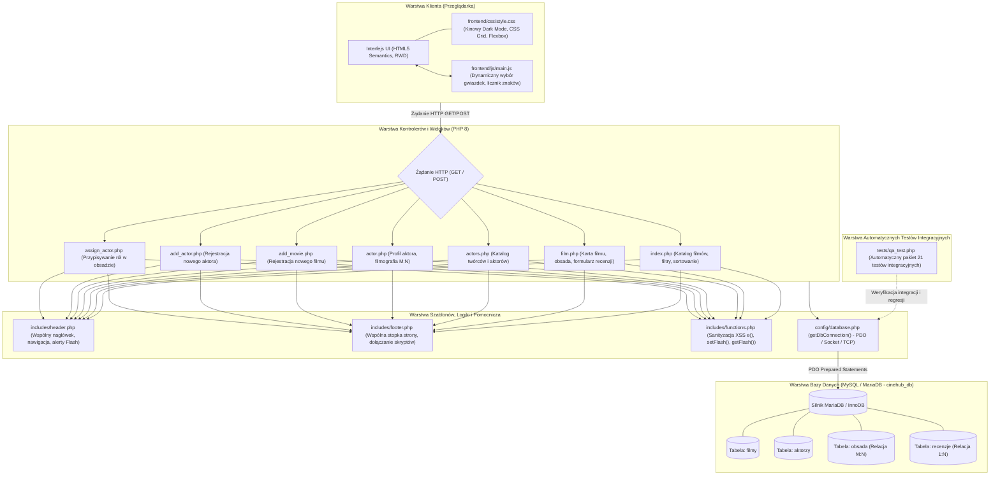
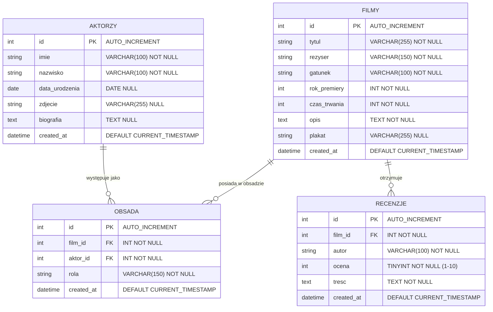
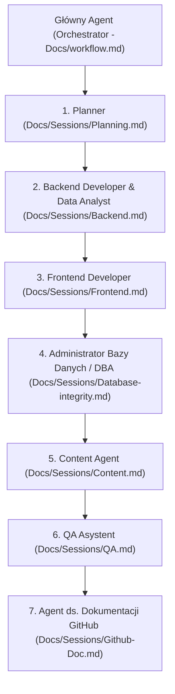

# SPECYFIKACJA TECHNICZNA I FUNKCJONALNA PROJEKTU CINEHUB
**Dokument wygenerowany przez:** Planner  
**Projekt:** Aplikacja Bazy Filmów (PHP / MySQL) – Zgodność z Kwalifikacją INF.03  
**Wersja:** 1.0  
**Status:** Zaakceptowana do realizacji  

---

## 1. Wstęp i Cel Projektu

Celem projektu jest stworzenie nowoczesnej, bezpiecznej i wydajnej aplikacji internetowej **CineHub** służącej do katalogowania filmów, zarządzania bazą aktorów, wiązania ról filmowych (relacja wiele-do-wielu) oraz publikowania i agregowania recenzji użytkowników.

Projekt powstaje zgodnie z najlepszymi praktykami programistycznymi oraz standardami egzaminacyjnymi kwalifikacji **INF.03** (*Tworzenie i administrowanie stronami i bazami danych oraz aplikacjami internetowymi*).

---

## 2. Wymagania Funkcjonalne

### 2.1 Moduł Filmów
- **Lista filmów (Strona główna / Katalog):**
  - Prezentacja filmów w formie czytelnych kart (plakat, tytuł, rok premiery, gatunek, czas trwania, wyliczona średnia ocena).
  - Wyszukiwarka tekstowa (po tytule) oraz filtrowanie według gatunku i roku premiery.
  - Sortowanie (po dacie dodania, roku premiery, średniej ocen).
- **Szczegóły filmu:**
  - Karta informacyjna filmu (pełny opis fabuły, reżyser, data premiery, czas trwania, plakat).
  - Sekcja obsady aktorskiej z wyszczególnieniem nazwy granej postaci.
  - Sekcja recenzji ze średnią oceną społeczności oraz liczbą recenzji.
  - Formularz dodawania nowej recenzji.
- **Zarządzanie filmami:**
  - Formularz dodawania nowego filmu do bazy wraz z walidacją danych.

### 2.2 Moduł Aktorów
- **Katalog aktorów:**
  - Przeglądanie listy aktorów (zdjęcie, imię, nazwisko, data urodzenia).
- **Profil aktora:**
  - Szczegółowe informacje: biografia, data urodzenia, zdjęcie.
  - Filmografia: lista filmów z bazy, w których dany aktor zagrał, wraz z nazwą odgrywanej postaci i odnośnikiem do filmu.
- **Dodawanie aktora:**
  - Formularz wprowadzania nowego aktora do bazy.

### 2.3 Moduł Relacji Film – Aktor (Obsada)
- Powiązanie typu M:N (wiele-do-wielu) pomiędzy filmami a aktorami.
- Możliwość przypisania aktora do konkretnego filmu wraz z zdefiniowaniem nazwy roli / postaci (`character_name` / `role_name`).
- Obsługa integralności referencyjnej (`CASCADE`).

### 2.4 Moduł Recenzji i Ocen
- Możliwość dodania recenzji do filmu:
  - Nazwa autora / pseudonim,
  - Ocena numeryczna w skali 1–10 (z interaktywnym komponentem wyboru),
  - Tekst recenzji / opinii.
- Dynamiczne przeliczanie i prezentacja średniej arytmetycznej ocen filmu.
- Walidacja integralności: ocena w przedziale 1–10, zabezpieczenie przed pustymi wpisami.

---

## 3. Wymagania Niefunkcjonalne i Architektoniczne

- **Architektura:** Warstwowa, modularna architektura bez zbędnego narzutu frameworków (czysty, zoptymalizowany PHP 8.x + MySQL / MariaDB).
- **Wymagania dotyczące Silnika Bazy Danych:**
  - **MySQL 8.0.16+** lub **MariaDB 10.3+** (starsze wersje, w tym MySQL 5.7, nie egzekwują ograniczeń integralności `CHECK`, traktując je wyłącznie jako dekorację składniową).
  - Silnik tabel: **InnoDB** (pełna transakcyjność, klucze obce z kaskadami `ON DELETE CASCADE ON UPDATE CASCADE`).
  - Kodowanie: `utf8mb4` / `utf8mb4_unicode_ci`.
- **Warstwa Danych:** Interfejs **PDO (PHP Data Objects)** z włączonymi wyjątkami (`PDO::ERRMODE_EXCEPTION`) i bezpiecznymi zapytaniami parametryzowanymi (**Prepared Statements**).
- **Bezpieczeństwo i Idempotencja Danych:**
  - Skrypt schematu `database/schema.sql` wykorzystuje wyłącznie klauzule `CREATE TABLE IF NOT EXISTS` – ponowne uruchomienie nie kasuje istniejących danych (brak `DROP TABLE` w standardowej instalacji).
  - Skrypt danych `database/seed.sql` jest w pełni idempotentny – nie zawiera `TRUNCATE`, nie nadpisuje rekordów użytkownika, a relacje obsady i recenzji wyznacza dynamicznie bez polegania na stałych identyfikatorach.
  - Opcjonalny reset deweloperski wydzielono do odrębnego, ostrzeżonego pliku `database/reset.sql`.
  - Ochrona przed **SQL Injection** poprzez wyłączne stosowanie zapytań przygotowanych (Prepared Statements).
  - Ochrona przed **XSS (Cross-Site Scripting)** przez filtrowanie i sanityzację wyjścia (`htmlspecialchars(..., ENT_QUOTES, 'UTF-8')`).
  - Podwójna walidacja danych wejściowych: po stronie klienta (HTML5 / JavaScript) oraz po stronie serwera (PHP `filter_var`).
- **Interfejs Użytkownika (Frontend):**
  - Semantyczny HTML5, nowoczesny i responsywny CSS3 (Flexbox/CSS Grid, kinowy motyw Dark Mode),
  - Vanilla JavaScript bez zewnętrznych bibliotek (asynchroniczność / interaktywność, dynamiczna walidacja formularzy).

---

## 4. Architektura Aplikacji i Struktura Katalogów

### 4.1 Diagram Przepływu Danych i Architektury Systemu (Mermaid)



### 4.2 Diagram Struktury Katalogów i Plików Projektu (Mermaid)

```mermaid
graph TD
    Root["cinehub/ (Katalog główny projektu)"]
    
    Root --> D_Frontend["frontend/"]
    D_Frontend --> D_CSS["css/"]
    D_CSS --> F_CSS["style.css (Kinowy motyw Dark Mode, RWD)"]
    D_Frontend --> D_JS["js/"]
    D_JS --> F_JS["main.js (Interaktywny selektor ocen, walidacja live)"]
    
    Root --> D_Config["config/"]
    D_Config --> F_DB["database.php (Połączenie PDO / MariaDB Socket & TCP)"]
    
    Root --> D_Database["database/"]
    D_Database --> F_Schema["schema.sql (Struktura DDL, CREATE TABLE IF NOT EXISTS)"]
    D_Database --> F_Seed["seed.sql (Idempotentne zasilenie polskimi filmami DML)"]
    D_Database --> F_Reset["reset.sql (Opcjonalny reset deweloperski - DROP TABLE)"]
    
    Root --> D_Includes["includes/"]
    D_Includes --> F_Header["header.php (Wspólny nagłówek HTML5 z nawigacją)"]
    D_Includes --> F_Footer["footer.php (Wspólna stopka HTML5)"]
    D_Includes --> F_Functions["functions.php (Funkcje pomocnicze: e(), flash)"]
    
    Root --> D_Tests["tests/"]
    D_Tests --> F_QATest["qa_test.php (Zautomatyzowany pakiet 21 testów QA)"]
    
    Root --> D_Docs["Docs/"]
    D_Docs --> F_Workflow["workflow.md (Instrukcja orkiestracji i 7 ról)"]
    D_Docs --> F_Specs["Specs.md (Specyfikacja techniczna i diagramy)"]
    D_Docs --> F_Report["Final-Report.md (Końcowy raport z realizacji)"]
    D_Docs --> D_Sessions["Sessions/"]
    D_Sessions --> S_Plan["Planning.md (Plan projektu Plannera)"]
    D_Sessions --> S_Back["Backend.md (Raport Backend Developera)"]
    D_Sessions --> S_Front["Frontend.md (Raport Frontend Developera)"]
    D_Sessions --> S_DBA["Database-integrity.md (Raport Administratora Bazy Danych)"]
    D_Sessions --> S_Content["Content.md (Raport Content Agenta)"]
    D_Sessions --> S_QA["QA.md (Raport QA Asystenta)"]
    D_Sessions --> S_Git["Github-Doc.md (Raport Agenta Dokumentacji GitHub)"]
    D_Sessions --> S_Audit["Verification-Audit.md (Raport audytu stanu projektu)"]
    
    Root --> D_Controllers["Główne skrypty i kontrolery PHP"]
    D_Controllers --> F_Index["index.php (Katalog filmów, filtry, wyszukiwarka)"]
    D_Controllers --> F_Film["film.php (Karta filmu, obsada, recenzje i formularz)"]
    D_Controllers --> F_Actors["actors.php (Katalog aktorów)"]
    D_Controllers --> F_Actor["actor.php (Profil aktora i filmografia M:N)"]
    D_Controllers --> F_AddM["add_movie.php (Rejestracja nowego filmu)"]
    D_Controllers --> F_AddA["add_actor.php (Rejestracja nowego aktora)"]
    D_Controllers --> F_Assign["assign_actor.php (Przypisywanie ról w obsadzie)"]
    
    Root --> D_RootDocs["Oficjalna dokumentacja projektu"]
    D_RootDocs --> F_ReadMeMD["README.md (Dokumentacja w formacie Markdown)"]
    D_RootDocs --> F_ReadMeTXT["README.txt (Dokumentacja w formacie tekstowym)"]
```



### 4.3 Rzeczywista Struktura Katalogów (Drzewo Tekstowe)

```text
cinehub/
├── Docs/
│   ├── workflow.md                 # Instrukcja orkiestracji zespołowej i 7 podagentów
│   ├── Specs.md                    # Niniejsza oficjalna specyfikacja techniczna z diagramami
│   ├── Final-Report.md             # Raport końcowy z realizacji całego projektu
│   └── Sessions/                   # Dziennik sesji poszczególnych ról (ściśle przypisane pliki)
│       ├── Planning.md             # Raport Plannera (Plan projektu i harmonogram)
│       ├── Backend.md              # Raport Backend Developera & Data Analysta
│       ├── Frontend.md             # Raport Frontend Developera
│       ├── Database-integrity.md   # Raport Administratora Bazy Danych (DBA)
│       ├── Content.md              # Raport Content Agenta
│       ├── QA.md                   # Raport QA Asystenta
│       ├── Github-Doc.md           # Raport Agenta ds. Dokumentacji GitHub
│       └── Verification-Audit.md   # Raport całościowego audytu stanu projektu
├── config/
│   └── database.php                # Konfiguracja połączenia PDO (localhost / socket unix / TCP)
├── database/
│   ├── schema.sql                  # Bezpieczna struktura tabel, kluczy i indeksów (CREATE TABLE IF NOT EXISTS)
│   ├── seed.sql                    # Idempotentne zasilenie danymi polskiego kina (DML bez TRUNCATE)
│   └── reset.sql                   # Opcjonalny, destrukcyjny skrypt resetu deweloperskiego (DROP TABLE)
├── frontend/
│   ├── css/
│   │   └── style.css               # Kinowy motyw Dark Mode (CSS Grid, Flexbox, RWD)
│   └── js/
│       └── main.js                 # Interaktywny selektor ocen (10 gwiazdek), walidacja live
├── includes/
│   ├── functions.php               # Funkcje pomocnicze: e() dla XSS, flash messages, formatowanie
│   ├── header.php                  # Wspólny nagłówek HTML5 z nawigacją i alertami Flash
│   └── footer.php                  # Wspólna stopka strony HTML5 ze skryptem JS
├── tests/
│   └── qa_test.php                 # Zautomatyzowany pakiet 21 testów integracyjnych
├── index.php                       # Strona główna: katalog filmów, filtry, wyszukiwarka
├── film.php                        # Szczegóły filmu, obsada, recenzje i formularz opinii
├── actors.php                      # Katalog aktorów z wyszukiwarką
├── actor.php                       # Profil aktora i jego filmografia (relacja M:N)
├── add_movie.php                   # Formularz dodawania nowego filmu
├── add_actor.php                   # Formularz dodawania nowego aktora
├── assign_actor.php                # Formularz przypisania roli w obsadzie
├── README.md                       # Oficjalna dokumentacja projektu w formacie Markdown
└── README.txt                      # Oficjalna dokumentacja projektu w formacie tekstowym
```

---

## 5. Struktura Bazy Danych (MySQL)

### 5.1 Diagram Relacji Encji (Mermaid ERD)



### 5.2 Definicje Kolumn i Ograniczeń Tabel

#### Tabela: `filmy`
| Kolumna | Typ | Ograniczenia | Opis |
| :--- | :--- | :--- | :--- |
| `id` | INT | PRIMARY KEY, AUTO_INCREMENT | Unikalny identyfikator filmu |
| `tytul` | VARCHAR(255) | NOT NULL | Tytuł filmu |
| `rezyser` | VARCHAR(150) | NOT NULL | Reżyser filmu |
| `gatunek` | VARCHAR(100) | NOT NULL | Gatunek (np. Sci-Fi, Kryminał, Akcja) |
| `rok_premiery` | INT | NOT NULL | Rok premiery (np. 2010) |
| `czas_trwania` | INT | NOT NULL | Czas trwania w minutach |
| `opis` | TEXT | NOT NULL | Zarys fabuły / opis filmu |
| `plakat` | VARCHAR(255) | NULL | Ścieżka lub URL do plakatu |
| `created_at` | TIMESTAMP | DEFAULT CURRENT_TIMESTAMP | Data dodania rekordu |

#### Tabela: `aktorzy`
| Kolumna | Typ | Ograniczenia | Opis |
| :--- | :--- | :--- | :--- |
| `id` | INT | PRIMARY KEY, AUTO_INCREMENT | Unikalny identyfikator aktora |
| `imie` | VARCHAR(100) | NOT NULL | Imię aktora |
| `nazwisko` | VARCHAR(100) | NOT NULL | Nazwisko aktora |
| `data_urodzenia` | DATE | NULL | Data urodzenia |
| `zdjecie` | VARCHAR(255) | NULL | Ścieżka lub URL do zdjęcia |
| `biografia` | TEXT | NULL | Krótki życiorys / biografia |
| `created_at` | TIMESTAMP | DEFAULT CURRENT_TIMESTAMP | Data dodania rekordu |

#### Tabela: `obsada` (Tabela łącząca relacji M:N)
| Kolumna | Typ | Ograniczenia | Opis |
| :--- | :--- | :--- | :--- |
| `id` | INT | PRIMARY KEY, AUTO_INCREMENT | Unikalny identyfikator wpisu |
| `film_id` | INT | NOT NULL, FK -> `filmy(id)` ON DELETE CASCADE | ID filmu |
| `aktor_id` | INT | NOT NULL, FK -> `aktorzy(id)` ON DELETE CASCADE | ID aktora |
| `rola` | VARCHAR(150) | NOT NULL | Nazwa odgrywanej postaci |
| `created_at` | TIMESTAMP | DEFAULT CURRENT_TIMESTAMP | Data przypisania |
*Indeks unikalny:* `UNIQUE KEY uq_film_aktor_rola (film_id, aktor_id, rola)` – zapobiega dublowaniu identycznych ról.

#### Tabela: `recenzje`
| Kolumna | Typ | Ograniczenia | Opis |
| :--- | :--- | :--- | :--- |
| `id` | INT | PRIMARY KEY, AUTO_INCREMENT | Unikalny identyfikator recenzji |
| `film_id` | INT | NOT NULL, FK -> `filmy(id)` ON DELETE CASCADE | ID ocenianego filmu |
| `autor` | VARCHAR(100) | NOT NULL | Imię / pseudonim recenzenta |
| `ocena` | TINYINT | NOT NULL, CHECK (`ocena` BETWEEN 1 AND 10) | Ocena punktowa (1-10) |
| `tresc` | TEXT | NOT NULL | Pełna treść recenzji |
| `created_at` | TIMESTAMP | DEFAULT CURRENT_TIMESTAMP | Data i godzina wystawienia |

---

## 6. Standardy Kodowania, Architektura Połączenia i Zabezpieczenia

1. **Konfiguracja Łączności z Bazą Danych (PDO):**
   - Domyślne łączenie przez `localhost` w `config/database.php` (automatyczne kierowanie przez szybkie i bezpieczne gniazdo uniksowe `/var/lib/mysql/mysql.sock` w systemie Linux bez wymogu otwierania portu TCP 3306).
   - Wsparcie dla zmiennej `DB_DRIVER=sqlite` na potrzeby zautomatyzowanych testów regresyjnych i środowisk CI.
   - Wymuszone opcje PDO: `PDO::ATTR_ERRMODE => PDO::ERRMODE_EXCEPTION`, `PDO::ATTR_DEFAULT_FETCH_MODE => PDO::FETCH_ASSOC`, `PDO::ATTR_EMULATE_PREPARES => false`.

2. **Zabezpieczenie przed SQL Injection:**
   - Wyłącznie zapytania parametryzowane PDO (Prepared Statements).
   - Przykładowy wzorzec:
     ```php
     $stmt = $pdo->prepare("SELECT * FROM filmy WHERE id = :id");
     $stmt->execute(['id' => $filmId]);
     $film = $stmt->fetch();
     ```

3. **Zabezpieczenie przed XSS (Cross-Site Scripting):**
   - Wyjście tekstowe renderowane w szablonach HTML zabezpieczone funkcją pomocniczą:
     ```php
     function e(?string $value): string {
         return htmlspecialchars((string)$value, ENT_QUOTES | ENT_SUBSTITUTE, 'UTF-8');
     }
     ```

4. **Wydajna Agregacja bez Iloczynu Kartezjańskiego:**
   - Pobieranie filmów wraz z powiązaną obsadą i recenzjami za pomocą podzapytań pre-agregujących (`derived tables`):
     ```sql
     SELECT 
         f.*,
         COALESCE(o.liczba_aktorow, 0) AS liczba_aktorow,
         COALESCE(r.liczba_recenzji, 0) AS liczba_recenzji,
         r.srednia_ocen
     FROM filmy f
     LEFT JOIN (
         SELECT film_id, COUNT(DISTINCT aktor_id) AS liczba_aktorow
         FROM obsada
         GROUP BY film_id
     ) o ON f.id = o.film_id
     LEFT JOIN (
         SELECT film_id, COUNT(id) AS liczba_recenzji, ROUND(AVG(ocena), 1) AS srednia_ocen
         FROM recenzje
         GROUP BY film_id
     ) r ON f.id = r.film_id;
     ```

---

## 7. Podział Ról w Zespole Wytwórczym (Workflow)

### 7.1 Diagram Orkiestracji Zespołu Agentów (Mermaid)



### 7.2 Przypisanie Odpowiedzialności i Plików Sesyjnych

1. **Planner:** Zbieranie wymagań, analiza architektury, utrzymanie `Docs/Specs.md` i diagramów Mermaid. Raport: [`Docs/Sessions/Planning.md`](Sessions/Planning.md).
2. **Backend Developer:** Logika aplikacji PHP, formularze POST, sanityzacja wejścia, wzorzec PRG, obsługa flash messages. Raport: [`Docs/Sessions/Backend.md`](Sessions/Backend.md).
3. **Frontend Developer:** Architektura CSS Dark Mode, semantyczny HTML5, skrypt interakcji (gwiazdki, licznik recenzji, walidacja UI). Raport: [`Docs/Sessions/Frontend.md`](Sessions/Frontend.md).
4. **Administrator Bazy Danych (DBA):** Integracja bazy z projektem, gniazda unix/TCP, poprawność DDL (`schema.sql`), indeksy, integralność referencyjna CASCADE, ograniczenia CHECK. Raport: [`Docs/Sessions/Database-integrity.md`](Sessions/Database-integrity.md).
5. **Content Agent:** Zasilenie bazy autentycznymi danymi polskiego kina (`database/seed.sql`), relacje obsadowe, realistyczne recenzje. Raport: [`Docs/Sessions/Content.md`](Sessions/Content.md).
6. **QA Asystent:** Automatyczny pakiet testów integracyjnych (`tests/qa_test.php`), audyt błędów i weryfikacja stabilności. Raport: [`Docs/Sessions/QA.md`](Sessions/QA.md).
7. **Agent ds. Dokumentacji GitHub:** Utrzymanie oficjalnej dokumentacji repozytorium (`README.md`, `README.txt`, `Final-Report.md`) oraz przygotowywanie komend git. Raport: [`Docs/Sessions/Github-Doc.md`](Sessions/Github-Doc.md).

